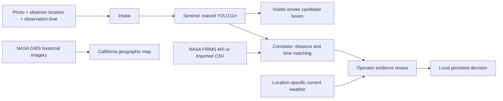

# WildfireWatch — evidence before escalation

**AI + Climate / ForgeHacks 2026.** A local research prototype for reviewing possible wildfire evidence across California. Residents submit photos and observer locations; an operator reviews trained YOLO smoke detections alongside satellite context and current local weather.

The project does not automatically confirm wildfires, notify authorities, or issue evacuation guidance. The resident/operator views are workflow roles, not production authenticated accounts. Run this installation for a single trusted operator.

## Run locally

The supplied local bundle includes `models/smoke-detector.pt`. Python 3.14 and Node 20+ support the pinned training/inference environment.

```sh
python3 -m venv .venv
.venv/bin/python -m pip install -r requirements-detector-inference.txt
npm ci
npm run build
ALLOWED_ORIGINS=http://127.0.0.1:8000,http://localhost:8000 .venv/bin/python -m uvicorn backend.app:app --host 127.0.0.1 --port 8000
```

Open **http://127.0.0.1:8000/**. The existing machine already has these dependencies and weights installed. No AI API credits are needed for the model. Map tiles and current weather require Internet access.

To share the complete React + FastAPI + YOLO app for a live demo without a persistent hosting bill, install [Cloudflare Tunnel](https://developers.cloudflare.com/cloudflare-one/connections/connect-networks/downloads/) and run `./scripts/share_demo.sh`. It builds the frontend, starts the local model/backend, and opens a temporary HTTPS tunnel. It prints a temporary operator password; share that with the link. Keep the Mac and terminal running during the demo, and press Ctrl-C afterward. The URL changes each time the tunnel restarts. This exposes the app publicly, so keep the generated password private.

For Vite development, run the backend on port 8787 instead, then `npm run dev`. Vite proxies `/api` and `/ws` to 8787.

## Demo

**Live camera option:** In the operator workspace, click **Analyze current frame** or **Start live monitoring**. The backend samples HPWREN's Los Pinos East color camera in San Diego County once per minute, runs the actual trained detector, displays timestamps and score, and adds smoke candidates to the review inbox. No AI API key is required. Monitoring runs while the backend is running, even with the browser closed; **Stop live monitoring** stops it. One camera does not provide statewide coverage.

Only new images are analyzed. Provider object-update timestamps older than five minutes are rejected (they are not independently verified capture times). Errors and unchanged frames appear in the last 30 checks; duplicate candidate reports are limited to one per five minutes. The monitor history is in memory; candidate reports persist in SQLite. Clear frames do not establish safety. Sunset, haze, clouds, and nighttime are difficult cases and can produce false positives.

Source metadata: https://www.hpwren.ucsd.edu/cameras/sites.js. Images retain their original embedded credits and timestamp, with model boxes displayed as a separate overlay. Attribution: HPWREN / UC San Diego / NSF and ALERTCalifornia. Follow HPWREN's [image-access guidance](https://www.hpwren.ucsd.edu/caminst.html) and [CC BY-NC-ND data-use conditions](https://www.hpwren.ucsd.edu/cc.html); this integration is a noncommercial research prototype, not a production decision service. No provider image is bundled into the public source repository.

1. In the operator workspace, click **Load smoke evidence**. This loads a held-out D-Fire image, with clearly staged coordinates/time.
2. Inspect the resident form and submit it for local review.
3. Show actual YOLO smoke bounding boxes, the observer position, and the live LangGraph stage trace.
4. Inspect the nearby **staged thermal anomaly**. It is invented for replay, not a NASA detection. The photo does not represent a fire at those coordinates.
5. Enable satellite imagery to view **real NASA Terra MODIS imagery dated 2021-07-22**. This is historical context, not footage of the photo or a prediction.
6. Fetch current weather for the report location; explain it is current, not historical incident weather.
7. Record an operator decision and notes. It persists locally, but sends no emergency notification.
8. Repeat with **Try cloud lookalike** to show that the trained model returns no smoke above 0.25.

See the [four-minute conversational video script](docs/VIDEO_DEMO_SCRIPT.md), [demo guide](docs/DEMO_GUIDE.md), and [ForgeHacks upload kit](submission-ready/README_FIRST.md).

## What is actually implemented



- **ML:** YOLO11n fine-tuned for smoke on Pyro-SDIS v2 and D-Fire. See [training and evaluation](docs/COMBINED_DETECTOR.md).
- **Orchestration:** actual LangGraph sequential Intake → Sentinel → Correlator stages, with Review awaiting a person; events stream over WebSockets.
- **Reporting:** image upload, manually entered/device observer location, optional viewing direction, UTC timestamp, notes, and SQLite persistence.
- **Review:** inbox, model boxes, source/time/proximity evidence, operator notes, escalation/dismissal/more-information status.
- **Map:** MapLibre/OpenFreeMap with terrain and observer/thermal markers. No Google Maps extension.
- **Satellite imagery:** NASA GIBS date-selectable true-color imagery. YOLO does not analyze satellite pixels.
- **Hotspots:** NASA FIRMS API with a configured free map key, or FIRMS-format CSV import. Live refresh was verified on October 10, 2026 and loaded 23 California observations in that session; counts and coverage vary by refresh. Imported-file provenance is not independently verified.
- **Weather:** Open-Meteo requests the selected observer coordinates. Current weather is explicitly separate from historical observation time.

Correlation matches loaded observations within 25 km and 24 hours. It does not establish a common fire, validate coordinates, or locate ignition. Missing satellite evidence does not rule out fire. The rectangular coordinate bounds cover California and nearby areas; they are not a precise state polygon.

The confirmed-fire map workflow can display an animated, terrain-based spread scenario using a selected point, current wind, local slope, and mapped cover. It is an illustrative sensitivity visualization—not a validated fire-growth forecast, measured perimeter, evacuation boundary, or responder instruction. See [scenario assumptions and limits](docs/FIRE_SCENARIO.md). Road-routing research does not establish safe evacuation instructions and is not presented as an approved route.

## Model results

15 training epochs; 25,065 training images, 3,412 validation, and 5,240 test. At score 0.25, combined image-level smoke precision is 95.1%, recall 76.8%, false-positive rate 4.9%. Recall on camera-disjoint Pyro-SDIS is only 53.1%. D-Fire near-duplicate leakage has not been fully audited. Scores are uncalibrated; these results do not establish field safety or a response-time benefit.

Weights are excluded from Git/static website publication. They are included in the local source bundle. Code-only clones require a trusted detector checkpoint; never load unknown PyTorch files. The hosted static Site cannot execute this Python model and clearly shows backend-offline state.

## Satellite configuration

Request a free key at https://firms.modaps.eosdis.nasa.gov/api/map_key/ and set `FIRMS_MAP_KEY` in the backend environment. With a local `.env`, use Uvicorn's `--env-file .env`. Never place secrets in the browser, source, or chat. Import CSV via **Satellite data & provenance**; required columns: `latitude`, `longitude`, `acq_date`, `acq_time` (UTC HHMM). Live NASA failures do not substitute staged observations.

SQLite reports live in `data/reports.sqlite` (Git-ignored). Hotspot imports are in memory and must be reloaded after restart; report evidence snapshots and decisions persist. This prototype lacks production authentication, spam/moderation tools, and a statewide camera network.

## Checks and deployment

```sh
.venv/bin/pytest -q
npm test
npm run build
```

[Backend hosting package](docs/BACKEND_DEPLOYMENT.md) and [Hugging Face staging script](deploy/prepare_huggingface.py) package the frontend/backend/model together. Online deployment is optional for the hackathon demonstration. No paid hosting or sponsor integration has been activated.

## Sources and licenses

- Pyro-SDIS v2: https://huggingface.co/datasets/pyronear/pyro-sdis (Apache-2.0)
- D-Fire collection and bundled demo photos: https://github.com/gaia-solutions-on-demand/DFireDataset (CC0-1.0 collection); provenance in `demo/frames/provenance.json`.
- Ultralytics: AGPL-3.0; review its obligations before redistribution/hosting.
- NASA GIBS: https://nasa-gibs.github.io/gibs-api-docs/
- NASA FIRMS: https://firms.modaps.eosdis.nasa.gov/
- Open-Meteo: https://open-meteo.com/
- MapLibre/OpenFreeMap/OpenStreetMap: attribution remains on the map.

Created during the October 2026 hackathon with AI coding assistance. ML inference is actual trained-model execution; staged evidence is labeled. Intended benefits have not been validated with emergency authorities.
